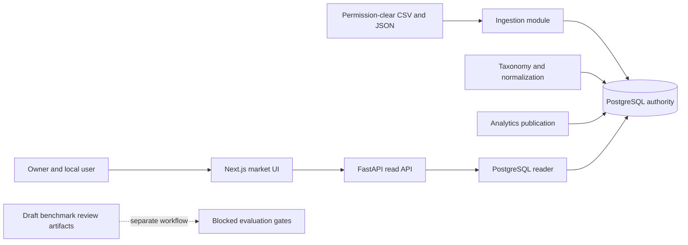
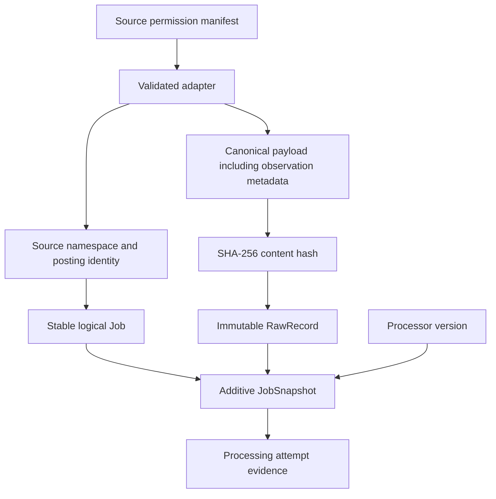
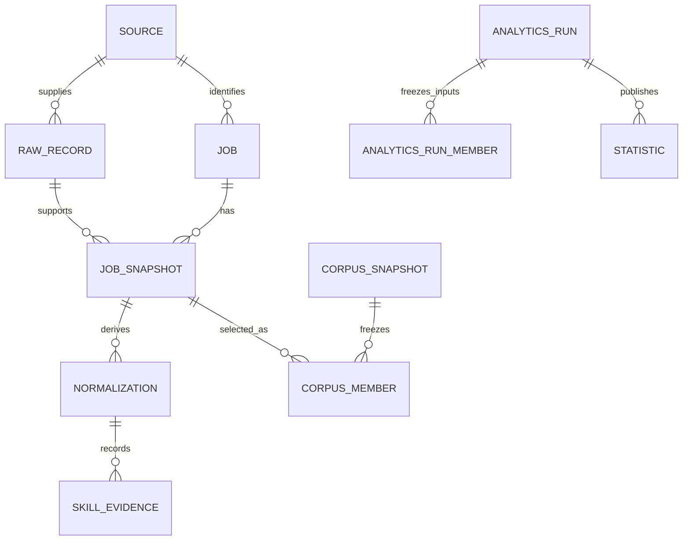
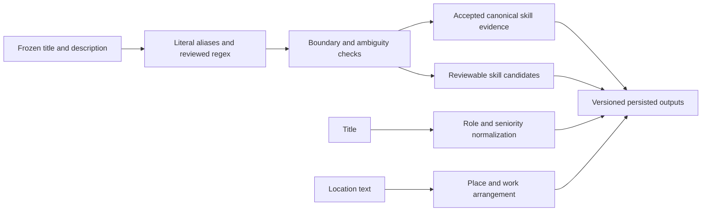
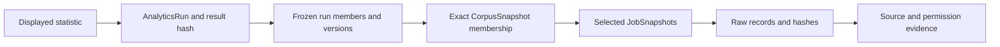
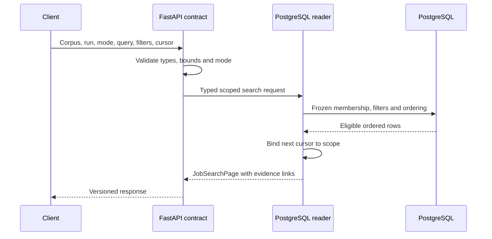
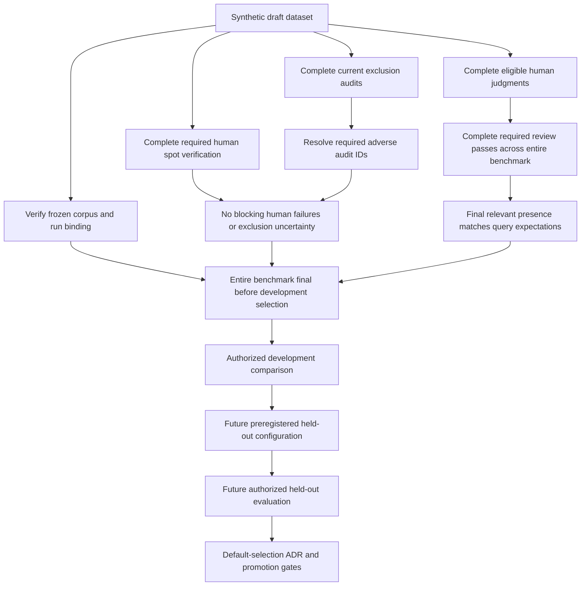

# Project Owner Handbook: Tech Market Intelligence

**An evidence-led guide to understanding, operating, explaining, and owning this project**

Repository: `G:/Projects/Tech-Market-Intelligence-M4`  
Documentation snapshot: **2026-10-10**, the provided environment date; original collection time was not captured.  
Scope: M0 through implemented M4.1/M4.2 and the incomplete M4.3 review work.  
Audience: the project owner, especially someone learning the engineering behind an AI-assisted build.

This handbook is educational documentation, not a release certificate. Only this handbook is edited; nothing is staged. No tests, database operations, retrieval evaluations, semantic audits, installations, builds, migrations, or review workflows ran for this assignment. Fresh lint/typecheck outcomes were captured by the documentation coordinator; see Chapter 18. Only explicitly identified project-related temporary records were read, never executed. Examples are teaching material; Markdown/Mermaid inspection is static, not rendered. Existing changes remain intact.

## Table of Contents

1. [Purpose and the Owner's Trust Contract](#1-purpose-and-the-owners-trust-contract)
2. [Evidence Rules and How to Read This Repository](#2-evidence-rules-and-how-to-read-this-repository)
3. [From the Original Video to Our Actual Project](#3-from-the-original-video-to-our-actual-project)
4. [How TMI Evolved: Every Major Prompt, Decision, and Architectural Revision](#4-how-tmi-evolved-every-major-prompt-decision-and-architectural-revision)
5. [Milestones M0 Through M4](#5-milestones-m0-through-m4)
6. [Understanding TMI From End to End](#6-understanding-tmi-from-end-to-end)
7. [Canonical Ingestion and Temporal Identity](#7-canonical-ingestion-and-temporal-identity)
8. [Taxonomy Normalization and Skill Evidence](#8-taxonomy-normalization-and-skill-evidence)
9. [Deterministic Analytics and Publication](#9-deterministic-analytics-and-publication)
10. [API Contracts and Evidence Access](#10-api-contracts-and-evidence-access)
11. [Frontend Behavior and Honest Presentation](#11-frontend-behavior-and-honest-presentation)
12. [M4 Structured Search and Pagination](#12-m4-structured-search-and-pagination)
13. [M4 PostgreSQL Lexical Retrieval](#13-m4-postgresql-lexical-retrieval)
14. [M4 Benchmark Design and Current Review State](#14-m4-benchmark-design-and-current-review-state)
15. [M4 Exclusion Audits and Protocol Evolution](#15-m4-exclusion-audits-and-protocol-evolution)
16. [Deep Knowledge Map and Practical Exercises](#16-deep-knowledge-map-and-practical-exercises)
17. [What I Must Learn to Take Full Ownership of TMI](#17-what-i-must-learn-to-take-full-ownership-of-tmi)
18. [Windows and Git Bash Operating Manual](#18-windows-and-git-bash-operating-manual)
19. [Decision Register Failures and Owner Choices](#19-decision-register-failures-and-owner-choices)
20. [Glossary and Further Learning](#20-glossary-and-further-learning)
21. [Can I Explain, Debug, Extend, and Defend TMI Without AI?](#21-can-i-explain-debug-extend-and-defend-tmi-without-ai)

GitHub and Obsidian support these ordinary Markdown heading links. Mermaid rendering depends on the viewer's configuration. Full paths in code spans are repository-relative unless explicitly absolute. Basenames and shortened paths are context-relative to the package or directory named nearby, not standalone root paths. Document links are relative to this file's `docs/` directory.

## 1. Purpose and the Owner's Trust Contract

TMI is an evidence-backed technical job-market system, not primarily a chatbot or resume scorer. Its promise: reproducible statistics retain their observation chain. Search and future AI help investigate evidence, not replace it with guesses.

**VERIFIED:** The approved product definition and differentiator appear in `tasks/plan.md:7` and `tasks/plan.md:13`. The M0 approval record repeats the local-first, PostgreSQL, deterministic-statistics, and optional-profile constraints in `docs/architecture/m0-approval.md:9`. These documents describe students, early-career technologists, career changers, educators, and analysts as intended users. They do not establish that actual users have validated the product.

Ownership means explaining implemented behavior, defensible claims, and evidence needed for the next investment. A working page alone establishes neither representative coverage, valid relevance labels, nor production readiness.

Suppose a dashboard says Python appears in three of six selected postings. The software may correctly calculate `3 / 6 = 0.5`. That does not justify saying half of all employers require Python. The defensible statement is that Python appears in half of the selected postings in this particular corpus, under its extraction rules and cutoff. If the postings are synthetic, even that statement describes a test fixture, not observed employer demand.

Attach four qualifiers to every claim: **population, time semantics, processing version, and evidence**. Missing denominators, unlabeled future systems, or scores without finalized judgments make claims incomplete or misleading.

Understand invariants well enough to reject unsafe changes: deleting snapshots damages reproducibility, models cannot silently revise frozen roles, and faster search is worse if it violates filters or evidence scope. Refusing to score unfinished gold protects the eventual result. This handbook separates source behavior, historical reports, and missing evidence.

**Exercise 1: Explain the promise.** In your own words, explain the difference between a job board, a market analytics platform, and an AI career assistant. Then describe which of those the current repository implements, which it partially implements, and which remain planned. Use [the approved plan](../tasks/plan.md), not marketing assumptions.

## 2. Evidence Rules and How to Read This Repository

The handbook uses four explicit labels. They describe the strength and kind of support for a claim, not whether the claim sounds plausible.

| Label | Meaning | Example in this project |
|---|---|---|
| **VERIFIED** | Supported by inspected source, static artifacts, or recorded Git history; scope must still be stated. | `canonical_json` sorts keys and prohibits NaN. |
| **RECONSTRUCTED** | A reasoned sequence or interpretation assembled from artifacts, not an exact recovered conversation. | The build moved from corpus correctness to retrieval evaluation. |
| **UNVERIFIED** | A claim or proposed behavior exists but was not independently demonstrated in the current environment. | A pinned corpus UUID currently resolves to the expected database contents. |
| **MISSING EVIDENCE** | Required material was not available or could not be recovered. | Original coding prompts and original video content. |

Source inspection establishes contained logic, not database migration, runtime correctness, or deployed versions. Reading tests establishes asserted contracts, not passing results. Reports establish recorded claims, not repeated measurements.

Match evidence to the question: source/contracts for current behavior, approved plans/ADRs for intent, commits/reports for history, and fresh authorized execution for runtime readiness. Runtime verification is outside this assignment.

Important entry points are [README](../README.md), [milestone checklist](../tasks/todo.md), [implementation plan](../tasks/plan.md), [project paper](project-paper.md), [architecture overview](architecture/overview.md), and [engineering contract](engineering/engineering-contract.md). Read them together rather than assuming any one is perfectly current. The paper's header still describes M3 as pending commit and says no M4 retrieval exists, while later source and Git history establish otherwise. This is documentation drift, not evidence that M4 code should be ignored.

The current research snapshot records branch `m4-search-and-retrieval-evaluation`, HEAD `87874cdbd45dbfe7976d3482ef78489cee154397`, and a linked worktree. Before this handbook, the baseline contained four modified tracked files: `README.md`, `pyproject.toml`, `scripts/tasks.ps1`, and `tasks/todo.md`. It also contained 32 individual untracked M4 files. Those are existing work, not changes authorized by this handbook task. An untracked implementation is visible in the worktree but absent from a clean checkout of HEAD.

That distinction affects reproducibility. A teammate who checks out the current commit may obtain structured and lexical search but not all draft benchmark tooling. A local handbook can describe those visible files while explicitly avoiding the claim that they are committed release assets. Never infer a clean repository from a successful commit history inspection.

Line references are navigation aids, not immutable citations. Uncommitted edits can move lines. When auditing an important claim later, inspect the named symbol, compare the relevant commit, and record the revision. Do not use the handbook to overwrite more precise evidence.

### Supplementary nonportable evidence inventory

Only these six named records were read from the preapproved temporary directory; no broad external search occurred. These **nonportable external records** are not release assets. Absolute code-span citations may be unavailable elsewhere. Inspection verifies contents, not embedded claims or authorship. Exact owner coding prompts: **zero recovered**.

| Named external record | Evidence and limit |
|---|---|
| `C:/Users/MAINAM~1/AppData/Local/Temp/opencode/m4_semantic_audit_120_20261006.py:21` | Hardcoded assessment list and serializer; upstream semantic authorship/session evidence missing. |
| `C:/Users/MAINAM~1/AppData/Local/Temp/opencode/retrieval-hardening-task_ff7fab911f8a.md:1` | Historical three-file, +51/-5 hardening account; line 61 records 14 passed, not a fresh test. |
| `C:/Users/MAINAM~1/AppData/Local/Temp/opencode/m4-verification-results.json:12` | Captured-output-style historical checks, no recorded run date; environment blockers and a failed probe also present. |
| `C:/Users/MAINAM~1/AppData/Local/Temp/opencode/m4-exclusion-results.json:12` | Separate historical exclusion/evaluation snapshot, not current verification. |
| `C:/Users/MAINAM~1/AppData/Local/Temp/opencode/m4-audit-results.json:12` | Separate historical audit-stage snapshot; sample progress precedes the persisted v1 run. |
| `C:/Users/MAINAM~1/AppData/Local/Temp/opencode/m4_finalize_verification.py:22` | Inserts a literal 23-passed probe claim, weaker than captured test stdout. |

No credentials or credential-bearing URLs from these records are reproduced. Temporary scripts were not executed, and their artifact-writing behavior is not authorized by this documentation task.

**Exercise 2: Classify evidence.** Label these statements: "the health endpoint exists," "PostgreSQL is currently reachable," "M3 once passed 23 integration tests," and "the original video recommended Qdrant." Explain why each needs a different kind of support.

## 3. From the Original Video to Our Actual Project

**MISSING EVIDENCE:** The original video was not available for direct comparison. The research inventory found no videos, subtitles, transcripts, or recoverable source references in the project-only material examined. Both `G:/Projects/Tech-Market-Intelligence/sources` and the active worktree's `sources` directory were missing. Inventories excluded dependency, cache, and `.git` directories; that is a bounded search, not a claim about every file on the computer.

Neither audio nor visuals were examined. Prior research reported missing media tools and transcription/video packages. **UNVERIFIED:** No retained inventory logs independently support those findings; missing tools do not prove missing media. No media was located, downloaded, transcribed, or installed. Historical transcription authorization is not established by the named records.

The honest comparison is therefore between an unavailable original and the earliest recoverable planning artifact. It is useful, but it is not a video summary. In particular, this chapter does not invent a title, speaker, transcript quote, timestamp, demonstration, or recommendation.

| Dimension | Original video | Our initial plan | Current implementation | Why it changed |
|---|---|---|---|---|
| Problem | **MISSING EVIDENCE** | Evidence-backed market insights, not opaque matching (`tasks/plan.md:7`, `tasks/plan.md:55`). | Corpus, analytics, UI, structured/lexical search (`README.md:7`). | **RECONSTRUCTED:** Staged delivery narrowed the implemented scope; no demonstrated change from the unavailable video. |
| Architecture | **MISSING EVIDENCE** | Modular monolith and PostgreSQL authority (`tasks/plan.md:15`). | In-process reader contract and PostgreSQL persistence (`apps/api/src/tech_market_api/market.py:22`, `packages/backend/src/tech_market_backend/analytics/persistence.py:31`). | Approved architecture was retained; specialized systems remain gated, not silently added. |
| Data | **MISSING EVIDENCE** | Permission-clear sources and additive observations (`tasks/plan.md:105`, `docs/project-paper.md:157`). | Validated file ingestion and frozen synthetic benchmark documents (`packages/backend/src/tech_market_backend/ingestion/service.py:43`, `data/benchmarks/retrieval/manifest.json:22`). | **RECONSTRUCTED:** Controlled fixtures permit correctness work before live-source and representativeness claims. |
| Technologies | **MISSING EVIDENCE** | FastAPI/PostgreSQL first, Next.js later, conditional Qdrant/Kafka (`tasks/plan.md:15`). | Python backend, Next.js/React UI, PostgreSQL lexical search (`pyproject.toml:10`, `package.json:18`, `README.md:13`). | Build order was followed; vectors and streaming lack completed measurement gates. |
| Evaluation | **MISSING EVIDENCE** | Extraction labels and staged retrieval comparison (`tasks/todo.md:45`, `tasks/todo.md:72`). | Synthetic extraction baseline and unfinished retrieval gold (`tasks/todo.md:55`, `data/benchmarks/retrieval/report.md:3`). | **RECONSTRUCTED:** Review and protocol hardening revealed why scoring must wait; improved contracts are not finished evaluations. |
| Deployment | **MISSING EVIDENCE** | Local-first, near-zero cost; operations later (`tasks/plan.md:15`, `tasks/todo.md:140`). | Local setup and recorded engineering checks, not verified production readiness (`README.md:32`, `README.md:99`). | Cost constraints remain; production reliability belongs to unfinished M9. |

**RECONSTRUCTED:** Relative to the recoverable plan, the implementation emphasizes evidence discipline before model sophistication. This interpretation is supported by build order, accepted ADRs, deterministic extraction, frozen publication inputs, and blocked retrieval scoring. It is not proof that the project departed from the video, because the video's content is unknown.

If media is supplied later, record source, access basis, date, and audio/visual inspection scope. Separate explicit statements from demo interpretation; connect comparisons to repository decisions. Missing visible provenance in a demo does not prove missing provenance in its hidden implementation. Keep missing evidence visible rather than inventing an origin story.

**Exercise 3: Prepare a comparison checklist.** On paper or outside protected repository artifacts, write five questions to ask when the original video becomes available. Include statistical authority, source permissions, evaluation, deployment complexity, and profile privacy. Leave all answers blank until evidence exists.

## 4. How TMI Evolved: Every Major Prompt, Decision, and Architectural Revision

**MISSING EVIDENCE:** Zero exact original coding USER prompts were recovered. The repository does not supply a trustworthy conversation transcript showing what the owner asked, what an assistant proposed, or who originated every decision. Git author identity establishes commit attribution, not conversational authorship. A document recording human approval is evidence of recorded approval, not a verbatim approval message.

This limitation does not prevent explaining development. It changes the form of explanation: use recovered artifacts and explicitly reconstructed intent instead of fabricated quotations. The exact machine exclusion-audit protocols exist in source; those are task specifications for an audit, not recovered owner prompt history.

The following sequence uses only supported milestone and commit ordering. It does not create numbered conversational turns.

| Iteration | Previous state | Prompt / decision | Implementation change | Validation | Outcome | Evidence |
|---|---|---|---|---|---|---|
| M0 | Approved concept | Record authority and scope; exact prompt missing. | Contracts and modular foundation. | Approval recorded, not transcript. | Foundation established. | `docs/architecture/m0-approval.md:3`; `3707083`. |
| M1 | Foundation only | Preserve canonical observations. | IDs, adapters, snapshots, provenance. | Source inspected; no fresh run. | Replays explainable. | `packages/backend/src/tech_market_backend/ingestion/identity.py:9`; `d5aecb7`. |
| M2 | Raw/parsed corpus | Deterministic versioned taxonomy first. | Extraction and ambiguity handling. | Historical synthetic report. | Baseline, not generalization. | `tasks/todo.md:55`; `130939d`. |
| M3 | Normalized corpus | Publish inspectable facts. | Frozen membership/run inputs, API, UI. | Historical checks, not repeated. | Committed and merged. | `tasks/todo.md:70`; `0b1c19b`, `af4649b`. |
| CI correction | Dependency installation insufficient | Install local project in CI. | Editable-project installation. | Historical commit evidence. | Environment fix, not universal readiness. | `5a1e416`. |
| M4.1 | Analytics browse | Add scoped structured search. | Filters and keyset pagination. | Contract/source evidence. | Implemented baseline. | `apps/api/src/tech_market_api/market.py:122`; `251477a`. |
| M4.2 | Structured search | Add opt-in lexical baseline. | Weighted query-time PostgreSQL FTS. | Documented parser contracts. | No default promotion. | `README.md:11`; `87874cd`. |
| M4.3 draft, undated revisions | Search without gold | Human-review-first benchmark. | Queries, pair judgments, review tooling. | Static artifacts; binding unverified. | Prepared, incomplete. | `data/benchmarks/retrieval/report.md:3`. |
| Preparation hardening, undated | Incomplete preflight/target guard | Refuse orphan manifests and non-list judgments; constrain DB target. | Three-file +51/-5 diff; exact approved URL guard. | Historical 14-passed account, not rerun. | Earlier safety defects bounded. | `C:/Users/MAINAM~1/AppData/Local/Temp/opencode/retrieval-hardening-task_ff7fab911f8a.md:1`. |
| Human-review hardening, undated | Earlier pass records | Preserve revisions and current obligations. | Append-only supersession; stale pass-2 detection. | Inspected tests, not execution. | History retained; review still pending. | `tests/evaluation/test_retrieval_revisions.py:79`; `tests/evaluation/test_retrieval_review_obligations.py:215`. |
| Semantic protocol v2, undated | Historical v1 interpretation | Filters authoritative; relevance separate. | Explicit fidelity and query-concern axes. | Source inspected; zero persisted v2 audits. | Contract improved, work unfinished. | `packages/backend/src/tech_market_backend/retrieval/exclusion_audit.py:45`. |
| JSON-pointer hardening, undated | Evidence resolver | Reject ambiguous array addressing. | Canonical ASCII indices and strict escapes. | Test assertions inspected only. | Fail-closed evidence contract. | `packages/backend/src/tech_market_backend/retrieval/exclusion_audit.py:335`; `tests/evaluation/test_retrieval_machine_audit.py:1460`. |
| Packaging/import readiness, undated | Review CLI imports another benchmark module | Include `benchmarks` in wheel. | Package list and absolute benchmark import. | Fresh installation/runtime unverified. | Separate local packaging change, not CI fix. | `pyproject.toml:34`; `benchmarks/review_retrieval.py:40`. |

**VERIFIED historical Git sequence:** `3707083` on September 20 established the foundation; `814ac7a` on September 21 addressed LF line endings; `d5aecb7` on September 21 added ingestion; `130939d` on September 22 added normalization; `0b1c19b` on September 26 added analytics/UI; `5a1e416` on September 27 fixed CI package installation; `af4649b` on September 27 merged M3; `251477a` on October 4 added structured search; and `87874cd` on October 4 added lexical search. These dates describe repository commits, not necessarily when every design idea was first discussed.

The historical CI fix `5a1e416` concerns installing the local project, not merely dependencies. **VERIFIED source; undated change:** Separately, the current wheel package list includes `benchmarks` at `pyproject.toml:39`, and `benchmarks/review_retrieval.py:40` imports `benchmarks.retrieval_audit_cli`. Including the package addresses import/distribution readiness. **UNVERIFIED:** A fresh install, CLI import, and runtime invocation were not tested here. Do not attribute this local packaging revision to the earlier CI commit.

**RECONSTRUCTED:** The M4 draft work continues after the latest committed search baseline, but the visible uncommitted revision history is not a dated sequence of owner requests. First-pass assessment revisions have recorded October 4 timestamps; human exclusion checks have October 5 timestamps; historical v1 machine records carry October 6 timestamps. These fields document artifact events, not measured execution durations or a complete conversational timeline. The date and exact owner wording that caused the v2 revision remain **MISSING EVIDENCE**.

Future documentation prompts should specify output path, allowed reads, prohibited execution/writes, evidence labels, and limitations. Implementation prompts also need acceptance criteria, test scope, database isolation, protected assets, and rollback. These are recommendations, not recovered prompts.

**Exercise 4: Write a bounded request.** Draft a future request to investigate a lexical-search defect without changing benchmark judgments. Include permission boundaries, expected evidence, prohibited workflows, and a stopping condition. Do not run it as part of this handbook.

## 5. Milestones M0 Through M4

Milestones are dependency gates. Use `tasks/todo.md:5` through `tasks/todo.md:84` for navigation; inspect source and history before consequential status claims.

### M0: Foundation

M0 defined the product, approved scope, selected tools, established contracts, and recorded architectural authority. It deliberately excluded ingestion, taxonomy, analytics, search, market UI, AI calls, profiles, external APIs, cloud resources, and optional infrastructure. This is a valuable constraint: foundation work should not quietly become feature development before approval.

The owner should be able to explain why the repository has separate application and package directories, why configuration does not contain committed secrets, and why contracts exist before a sophisticated interface. The deliverable is a reproducible engineering base, not visible market value.

### M1: Canonical corpus

M1 introduces source manifests, validated CSV/JSON adapters, deterministic IDs, raw observations, logical jobs, parsed snapshots, processing attempts, failures, and provenance inspection. Exact replay should avoid duplicate canonical entities; changed canonical input should produce an additive observation or snapshot as appropriate.

The checklist's broad "retry" wording should not be inflated into a durable retry service. **VERIFIED:** Actual ingestion records processing attempts on replay, but there is no operational background retry queue. Similarly, an M1 processing state named `NORMALIZED` does not establish completion of the separate M2 taxonomy pipeline. Names can be historical conveniences rather than proof of feature breadth.

### M2: Normalization and skill intelligence

M2 supplies versioned canonical skills, aliases, relationships, source spans, normalization, ambiguity handling, persistence, and a synthetic evaluation dataset. It establishes a deterministic baseline. It does not demonstrate multilingual completeness, arbitrary title understanding, or market-wide extraction accuracy.

The recorded benchmark has 24 synthetic English examples. Skill counts are 71 true positives, four false positives, and zero false negatives, giving precision approximately 0.9467 and recall 1. Seniority is correct on 20 of 24 examples. The reported location evaluation measures work arrangement, not comprehensive geographic resolution. These are useful engineering findings, but small synthetic evidence cannot support broad performance claims.

### M3: Deterministic analytics and first useful UI

M3 selects one observation per job at a cutoff, freezes exact membership and derived inputs, publishes versioned metrics, exposes paginated APIs, and provides an evidence drill-down interface. It has three key achievements: repeatable membership, inspectable calculations, and coherent presentation tied to a run.

**VERIFIED historical record, not fresh execution:** Repository documentation records 88 Python non-integration tests, 23 isolated PostgreSQL integration tests, and 19 Vitest UI tests, plus formatting, lint, strict typing, build, and migration checks. M3 is committed and merged; the project paper's pending-commit header is stale. The six-job engineering report demonstrates local mechanics, not representative market behavior or production capacity.

### M4: Retrieval

M4.1 structured SQL search and M4.2 PostgreSQL lexical retrieval are implemented and committed. M4.3 benchmark preparation is visible but incomplete. M4.4 provider-neutral embedding/index contracts, M4.5 dense/hybrid evaluation, M4.6 conditional reranking, and M4.7 default-selection ADR remain unfinished.

M4 completion requires valid judgments and meaningful held-out evidence, not simply a lexical endpoint. The default remains structured when mode is omitted. No current draft benchmark result promotes lexical, dense, or hybrid retrieval. M5's grounded assistant, M6's trends/live sources/prompt experiments, M7's profiles, M8's durable queue, and M9's operations remain future milestones.

**Exercise 5: Demonstrate dependencies.** Explain why adding an assistant before corpus and metric provenance would make unsupported answers harder to detect. Then explain why adding embeddings before gold judgments would make retrieval improvement hard to establish.

## 6. Understanding TMI From End to End

Seven conceptual diagrams show responsibility boundaries, not exhaustive table/process inventories. Operational diagrams omit future infrastructure and distinguish observations, frozen inputs, and unfinished gates.

### Diagram 1: Current component map



The backend is a modular monolith: one codebase with internal responsibility boundaries. Separate API and CLI entry points do not automatically make it microservices. PostgreSQL remains authoritative for facts. JSON benchmark artifacts support evaluation governance; they do not replace the database as operational truth.

### Diagram 2: Observation and identity chain



A logical job and its observation are different identities. Hashing preserves exact canonical content; UUID derivation preserves deterministic identity. Permission metadata governs whether the source may be used at all. Processing attempts explain execution even when canonical data already exists.

### Diagram 3: Conceptual persistence relationships



This is a conceptual ER view, not a claim that every diagram label is an exact table name. Consult `packages/backend/src/tech_market_backend/platform/models.py` and migrations for concrete schema. Its main lesson is that observations, normalization outputs, membership, and published results have separate lifecycles.

### Diagram 4: Deterministic extraction boundary



Unknown and ambiguous outputs are legitimate. The absence of a model is intentional. A future model stage would require its own authority, evaluation, and review rules; it cannot be inferred from this diagram.

### Diagram 5: Market-fact provenance



The chain works backward from a claim to its supporting observations. A statistic's evidence set may show positive contributors, while its denominator depends on the whole eligible cohort. Reading only positive evidence cannot reconstruct prevalence.

### Diagram 6: Scoped search request



Pagination is part of correctness. A cursor should not be reusable against a different query or run. Lexical anchor rank is recomputed in SQL rather than trusted from a rounded client value.

### Diagram 7: Retrieval release gates



This is a dependency explanation, not an instruction to execute these workflows now. The current held-out runner remains disabled even after preregistration validation. Reaching one gate does not grant permission to skip another.

**Exercise 6: Redraw architecture.** Without looking, draw the market-fact chain and identify which element would be lost if normalized skills were read live instead of frozen per run. Compare your drawing with Diagram 5.

## 7. Canonical Ingestion and Temporal Identity

The ingestion module lives under `packages/backend/src/tech_market_backend/ingestion/`. Read `contracts.py`, `adapters.py`, `identity.py`, `service.py`, and `provenance.py` as one pipeline. They separate validation, identity, persistence, and inspection rather than mixing every concern into the CLI.

**VERIFIED:** `canonical_json` in `packages/backend/src/tech_market_backend/ingestion/identity.py:9` sorts keys, uses compact separators, preserves Unicode, rejects NaN, and emits UTF-8 bytes. `content_hash` at line 15 computes SHA-256 over those bytes. `job_uuid` at line 23 uses source namespace plus source posting ID or canonical URL; it does not use title and company alone. `snapshot_uuid` at line 34 incorporates job ID, digest, and processor version.

Canonicalization makes content addressing predictable. Two dictionaries with the same keys and values in different insertion order should yield the same digest. By contrast, a changed observation timestamp or metadata can change the canonical payload hash even when visible description text is unchanged. The current payload includes metadata and time; describing its hash as "description hash" would be wrong.

UUIDv5 derives deterministic namespace identifiers; SHA-256 addresses content. Neither establishes source permission, truth, or privacy. Identifiers are not secrets; hashes are not encryption.

Raw observations are preserved so later parser changes can be understood. A `Job` represents a stable posting identity; a `JobSnapshot` records a parsed state. Additive snapshots let an owner explain why a historical statistic differs from a newer one. Overwriting a posting in place would erase that explanation.

The implementation uses per-row transactions and records processing attempts on replays. This limits the blast radius of a malformed row and preserves execution evidence. It also means an accepted-row count may include exact duplicates accepted through validation; it is not necessarily a count of newly created logical jobs. Read count definitions before presenting import throughput or corpus growth.

Idempotency should be stated precisely: replaying equivalent canonical records avoids duplicate canonical entities, but may still create new attempt records. Changed payloads can create additional raw records or snapshots. A parser-version change can affect snapshot identity. This is more informative than saying "running import twice changes nothing."

Source permission is part of correctness. Public availability does not grant storage, redistribution, or training rights. Approved synthetic files support engineering; live adapters, safe closure semantics, and durable workers remain future work.

**Exercise 7: Trace a record without execution.** Open a fixture row, its permission manifest, `identity.py`, the `JobSnapshot` model, and provenance contracts. Write the chain from source namespace to job ID, content digest, snapshot ID, raw evidence, and eventual corpus membership. Explain which identities stay stable if only the title changes.

**Exercise 8: Predict replay behavior.** Consider an exact replay, a changed `observed_at`, and a changed processor version. Predict logical-job, raw-record, snapshot, and attempt behavior separately. Check source before claiming all three cases are duplicates. This exercise is conceptual; do not import records into any database.

## 8. Taxonomy Normalization and Skill Evidence

Normalization translates noisy text into controlled values. Extraction records evidence for technologies in source text. They interact, but they are not interchangeable. A title can normalize to a role while the description yields no accepted skills; a skill mention can be accepted while role remains unknown.

The implementation lives under `packages/backend/src/tech_market_backend/taxonomy/`. Important files include `catalog.py`, `contracts.py`, `extraction.py`, `normalization.py`, `persistence.py`, `evaluation.py`, and `versions.py`. ADR-005 explains deterministic taxonomy authority and versioning. The current catalog contains 31 canonical skills, not a comprehensive inventory of every technology.

**VERIFIED:** Role normalization has nine canonical role families. `_ROLE_ALIASES` begins at `packages/backend/src/tech_market_backend/taxonomy/normalization.py:7`. `normalize_role` at line 61 uses bounded alias matches and returns ambiguity when multiple roles remain. It specifically removes a generic software-engineer match when the more specific machine-learning-engineer match is also present. This is an explicit exception, not general natural-language understanding.

Seniority uses ordered precedence at line 29 and `normalize_seniority` at line 77. That makes behavior predictable but can produce false positives: a title containing "manager" for a non-management meaning can outrank other labels. More rules are not automatically better; each should be evaluated against counterexamples.

Geographic normalization is a six-entry whitelist at line 41. Work arrangement is separately detected as remote, hybrid, or onsite. `normalize_location` at line 84 may recognize arrangement without resolving a city, or flag multiple arrangements as ambiguous. Unknown geography must not be silently inferred from an employer or a reader's world knowledge.

Literal aliases are escaped for regex matching; a technology name containing punctuation should not accidentally become a regex operator. Boundary checks protect against matching a short name inside unrelated words. Go and R require particular care because ordinary English can contain those strings. Ambiguous contexts should produce candidates or abstention rather than authoritative skill evidence.

Accepted extraction preserves source spans and method/version information. A span lets the owner point to the exact substring responsible for a claim. When teaching extraction, check both the canonical skill key and the evidence location. A correct skill attached to an unrelated span still weakens traceability.

The current versions are `skills-2026-09-22`, `normalization-2026-09-01`, and `extraction-2026-09-22`. Versions matter because changing aliases or precedence can alter counts while raw text remains unchanged. Historical analytics must retain the older input set rather than silently reinterpreting it.

Confidence `1` in this deterministic baseline is a method marker, not a calibrated probability that the claim is true. Do not say "100% confidence" to a user as if the extractor had empirical certainty. The synthetic evaluation's four false positives already show why that interpretation fails.

**Exercise 9: Build ambiguity examples.** On paper, create two positive and two negative sentences for Go and R. Identify why a boundary-only detector can fail and what contextual evidence would help. Do not alter taxonomy or benchmark gold.

**Exercise 10: Interpret the report.** Calculate `71 / (71 + 4)` and `71 / (71 + 0)`. Explain why excellent recall on 24 synthetic examples does not imply excellent recall on Vietnamese postings, unseen titles, or a larger live corpus.

## 9. Deterministic Analytics and Publication

Analytics converts a selected corpus into facts under explicit definitions. It does not ask a model to infer percentages. Read `packages/backend/src/tech_market_backend/analytics/engine.py`, `registry.py`, and `persistence.py`, together with [metric definitions](metrics/market-metrics.md).

**VERIFIED:** `GoldenJob` at `analytics/engine.py:12` describes analytic inputs. `Statistic` at line 28 carries value, numerator, denominator, unit, dimensions, cutoff, corpus ID, versions, warning, evidence, and metadata. `AnalyticsEngine.snapshot` at line 54 excludes observations after the cutoff, selects the greatest `(observed_at, snapshot_id)` per logical job, and returns a deterministic job ordering.

Selecting one snapshot per logical job prevents multiple observed revisions from counting as separate jobs. The cutoff is inclusive. Tied observation times use the greatest snapshot UUID in the implemented ordering. This tie-break is deterministic; it is not proof that one tied observation is semantically better.

Publication freezes membership, selected normalization, accepted skills, and versions. Unnormalized jobs remain in authoritative denominators; dropping extraction failures could inflate prevalence.

`AnalyticsPersistence` starts at `packages/backend/src/tech_market_backend/analytics/persistence.py:31`. Its input envelope uses `analytics-run-input-2` at line 86. The input hash includes corpus and version information, selected role pair, metric definitions, and frozen members. A deterministic run UUID derives from the input hash. Persisted result values are normalized to ten decimal places using `ROUND_HALF_UP` at line 337 so result hashing agrees with stored numeric representation.

The four implemented metric families are skill prevalence, role comparison, location distribution, and skill co-occurrence. Skill prevalence is the proportion of selected jobs containing an accepted skill, counting each job once per skill. Repeated mentions do not increase the numerator. Co-occurrence counts jobs containing both skills; it is not evidence that one skill causes demand for another.

Role comparison deserves careful reading. The engine stores combined numerator and denominator plus separate left/right counts in metadata. A client should use the side-specific denominators when comparing role prevalences. The combined value alone does not mean "difference between roles." Read `role_comparison` at `analytics/engine.py:121` before explaining the UI.

Unknown locations remain represented. Cohorts smaller than ten produce a small-sample warning. Skill distribution emits observed skills, not zero-valued rows for every absent skill in the taxonomy. Therefore absence of a metric row is not always equivalent to a stored zero statistic.

**Educational Python only, not new implementation:** Four invented selected jobs include two Python/SQL jobs, one SQL-only job, and one unnormalized job. This miniature calculation preserves the full denominator; it does not reproduce the publication engine or persisted hashes.

```python
from decimal import Decimal

jobs = [{"python", "sql"}, {"python", "sql"}, {"sql"}, set()]
numerator = sum("python" in skills for skills in jobs)
denominator = len(jobs)
prevalence = Decimal(numerator) / Decimal(denominator)
assert (numerator, denominator, prevalence) == (2, 4, Decimal("0.5"))
```

Python prevalence and Python-SQL co-occurrence are both `2 / 4`, not `2 / 3`. These invented inputs are not repository benchmark results; the snippet was not executed.

**Exercise 11: Calculate by hand.** Using the four-job teaching example, write numerator, denominator, value, evidence IDs, and a small-sample warning. Then explain why positive evidence IDs alone cannot reveal the denominator.

**Exercise 12: Inspect a migration.** Read `migrations/versions/0003_m3_analytics.py` and locate structures corresponding to corpus membership, run inputs, and published statistics. Compare them with `platform/models.py`. Do not run Alembic; the goal is to understand what a migration changes and what rollback could destroy.

## 10. API Contracts and Evidence Access

The API separates HTTP validation from database reading. The application package is `apps/api/src/tech_market_api/`; shared models are in `packages/contracts/src/tech_market_contracts/`. `market.py` defines `MarketReader`, route functions, typed validation errors, and page constraints. `postgres_reader.py` implements database-backed reads.

**VERIFIED:** `MarketReader` starts at `apps/api/src/tech_market_api/market.py:22`. It exposes market, jobs, evidence, and search methods. `routes` at line 87 registers `/api/v1/market`, `/api/v1/jobs`, and `/api/v1/evidence`. Route contracts include `GET /api/v1/market/{metric}`, `GET /api/v1/jobs`, `GET /api/v1/evidence/{snapshot_id}`, and `GET /api/v1/jobs/search`.

`/health` reports application health, not database readiness. A process can answer health while market reads fail because PostgreSQL is unconfigured or unavailable. Production readiness would need broader checks and operational policy; do not invent that behavior from a single endpoint.

Search requires a corpus `snapshot` UUID and compatible successful `analytics_run_id`. It defaults to structured mode. Lexical mode requires a nonblank query. Filters include role, seniority, location, repeated `skill`, and inclusive observed-time bounds. `skill` is the HTTP parameter name; `skills` is the reader's list argument. That small distinction matters when constructing requests.

The route validates lengths, empty values, NUL bytes, duplicate skills, timezone-aware dates, cursor length, and page size. Invalid inputs use structured 422 error envelopes rather than arbitrary success responses. Type validation is not equivalent to complete domain correctness, but it creates an inspectable boundary.

Evidence detail is corpus-scoped. Supplying a real snapshot UUID does not entitle a request to evidence outside the selected corpus. This prevents misleading drill-downs that mix published statistics with unrelated observations. Search summaries do not include full descriptions even though descriptions participate in lexical matching.

An illustrative request, to be used only against an already authorized read-only local service, is:

```text
GET /api/v1/jobs/search?snapshot=8bfb4784-ba90-54f4-94da-d96fde558faf&analytics_run_id=68e00d95-9c81-5ef1-8686-348b04e4ec7d&mode=lexical&query=Python&skill=python&limit=10
```

These UUIDs come from the draft manifest. **UNVERIFIED:** Their current database binding was not rechecked for this assignment. The request is an example of syntax, not a promise that a running service will accept it or return a particular result count.

**Exercise 13: Read a contract.** Open `packages/contracts/src/tech_market_contracts/market.py` and find the search page and statistic contracts. Explain which fields establish pagination, evidence, scope, and version identity.

**Exercise 14: Trace an API failure.** Follow `QUERY_INVALID` from `market.py:149` into application error handling. Explain the difference between a malformed request, a missing corpus, a run mismatch, and an unavailable database. Do not provoke those failures by starting services during this assignment.

## 11. Frontend Behavior and Honest Presentation

The UI is the first useful experience, not the center of statistical authority. Its job is to display facts, qualifiers, and evidence without confusing users. The main files are `apps/web/app/page.tsx`, `apps/web/lib/market.ts`, and `apps/web/app/evidence/[snapshotId]/page.tsx`. Tests sit beside these files.

**VERIFIED:** `Statistic` in `apps/web/lib/market.ts:1` preserves numerator, denominator, versions, warnings, and evidence. `loadMarketPage` at line 64 fetches with `cache: "no-store"`, requires a resolved analytics run ID, and rejects a different run when one is expected. `loadDashboard` at line 104 obtains API and snapshot configuration, validates role-pair selection, and manages a pinned run across panels.

Pinning protects coherence. If the skill panel uses one run and the location panel uses another, users may compare numbers from different inputs without noticing. The UI's `RUN_MISMATCH` behavior is therefore more than defensive programming; it protects the meaning of the page.

A decimal statistic is represented as a string in the frontend contract. That avoids pretending all persisted precision should be carried as binary floating-point JSON numbers. Display formatting can still convert for presentation, but authoritative numerator and denominator remain important.

Evidence panels should expose sample size, cutoff, versions, and synthetic-data limits. Correct arithmetic does not justify a headline implying an entire hiring market.

Testing Library/Vitest cover jsdom error states, links, accessible names, and rendering contracts, not real-browser accessibility, responsive layout, keyboard usability, or performance. No browser inspection ran for this handbook.

Configuration is another ownership topic. `API_URL`, `CORPUS_SNAPSHOT_ID`, and selected run/role settings guide server-side loading. Missing configuration is different from an empty market. A blank or fallback page should not be interpreted as evidence that no jobs exist.

**Exercise 15: Audit a displayed claim.** Read a dashboard panel and write the exact sentence a user is entitled to infer. Include corpus, cutoff, denominator, and synthetic-data limitation. Then write one tempting but unjustified headline and explain its problem.

**Exercise 16: Trace frontend failure isolation.** Follow the special role-panel error codes in `apps/web/lib/market.ts:62`. Explain why one invalid comparison should be distinguished from total market API failure. Compare unit expectations with what a later real-browser test would still need to establish.

## 12. M4 Structured Search and Pagination

Structured search is the correctness baseline. It combines explicit metadata constraints with title/company substring matching. It is not semantic search, and it does not understand a conceptual query merely because a human can.

**VERIFIED:** M4.1 is marked complete at `tasks/todo.md:74`; its API contract starts at `apps/api/src/tech_market_api/market.py:122`. Omitted mode and `mode=structured` preserve this behavior. Query-time logic in `postgres_reader.py` applies frozen run inputs and exact corpus membership rather than reading whatever normalization happens to be newest.

Role, seniority, and location filters compare canonical frozen values. All requested skills must be present; requesting Python and SQL means both, not either. Active constraints combine with AND. Observed bounds are inclusive and refer to observation time, not a date mentioned in the description or a guessed publication date.

Substrings match title/company, not description. They neither expand aliases nor infer roles from duties. Narrow, explicit behavior makes this a useful correctness baseline.

Keyset pagination avoids the instability of large offsets and makes continuation depend on ordered values. Imagine two records sharing an observation time. A unique stable tie-break prevents one from disappearing between pages. The cursor also needs to bind the request's corpus, run, filters, query, and page size so continuation cannot silently cross scopes.

Cursors preserve scope/order, not authorization. Private features still need access control; anonymous APIs must also reject cross-scope continuation.

**Exercise 17: Work out eligibility.** Suppose a frozen document has role `backend_engineer`, seniority `unknown`, location `London`, skills `python` and `sql`, and observation date January 12. A query requires role `backend_engineer`, location `London`, skills `python` and `aws`, and an upper bound of January 12 inclusive. The document is excluded because AWS is missing; date equality passes. Intent similarity cannot change that result.

**Exercise 18: Design a pagination test.** On paper, construct three rows with equal observation times and different UUIDs. Predict first and second pages under the implemented ordering. Add a changed filter and explain why the old cursor must be rejected. Do not modify test files in this documentation task.

Separate filtering correctness from relevance quality. Correct zero eligibility can expose poor query construction; eligible documents can still be irrelevant.

## 13. M4 PostgreSQL Lexical Retrieval

Lexical mode is an opt-in baseline using PostgreSQL full-text search. It does not require a vector database or model provider. Read `README.md:11` through `README.md:17` alongside `apps/api/src/tech_market_api/postgres_reader.py` before describing its behavior.

**VERIFIED:** The query parser uses explicit `simple` configuration and `websearch_to_tsquery`. Unquoted terms combine with AND; uppercase OR permits alternatives; a minus excludes terms; quotes request adjacent positions. Unmatched quotes are tolerated by the parser. Punctuation-only queries return no matches.

The `simple` configuration lowercases but does not stem. Consequently `running` and `run` differ. Technology punctuation is not preserved perfectly: C++ becomes `c`, .NET becomes `net`, and Node.js retains a dotted lexeme. Canonical skill keys such as `cpp` are included, but expanded aliases are not. Searching a human spelling is not guaranteed to behave like searching its canonical skill key.

The document combines weighted fields: title A with weight 1.0, frozen canonical skills B with weight 0.4, company C with weight 0.2, and description D with weight 0.1. Skills come from the selected `AnalyticsRunMember` JSONB array, not live extraction tables. `jsonb_to_tsvector` transforms that skill content into the document representation.

Ranking uses `ts_rank_cd` with default weights and normalization 0. Results order by rank descending, observed time descending, and snapshot UUID ascending. A lexical cursor includes mode/version and request scope. Its anchor rank is recomputed in SQL to avoid mismatches caused by serializing and rounding a floating-point score.

Concatenated vectors can allow quoted phrases across field boundaries. A phrase match is not guaranteed to occur entirely within one field. This behavior is worth teaching because a search demo can look convincing while hiding semantics a user did not expect.

There is no added schema migration or dedicated GIN index for this query-time document. The document spans immutable snapshots and run-specific frozen skills; a materialized indexed representation would need lifecycle, backfill, publication, and rebuild decisions. Current FTS is a correctness baseline, not a claim of production throughput. A rebuildable index may later be justified by representative measurements.

Do not confuse lexical relevance with corpus eligibility. Structured filters still execute inside retrieval SQL. A highly ranked text match cannot override a failed role or skill filter. Evidence links remain pinned to the requested corpus, and descriptions remain absent from summaries.

**Exercise 19: Predict parser behavior.** Explain how `Python PostgreSQL`, `Python OR PostgreSQL`, `Python -AWS`, and a quoted two-word phrase differ. Then identify why C++ and .NET need explicit counterexample tests rather than assumptions based on the visible query string.

**Exercise 20: Explain an index proposal.** Write a short design note outside protected artifacts comparing query-time FTS with a run-specific materialization. Include membership, frozen skills, invalidation, publication, storage, rebuild, and deletion. Do not propose a GIN index without specifying what expression or materialized document it indexes.

## 14. M4 Benchmark Design and Current Review State

A benchmark defines what "better retrieval" means. It needs frozen documents, meaningful query families, valid eligibility, finalized human relevance grades, reproducible configurations, and explicit metrics. A large JSON file is not automatically gold data.

Primary artifacts are `data/benchmarks/retrieval/queries.json`, `manifest.json`, `judgments.json`, `protocol.json`, `adjudication-guide.md`, `review-packet.jsonl`, and `report.md`. Tooling is in `benchmarks/run_retrieval.py`, `benchmarks/review_retrieval.py`, and the backend retrieval package. Many draft assets are untracked in the baseline, so source visibility and committed availability differ.

**VERIFIED static research snapshot:** The fixture contains 36 rows representing 32 logical jobs. The selected corpus contains 32 documents at cutoff `2026-10-01T00:00:00Z`. There are 50 distinct query families: 30 development and 20 held-out. Exhaustive pairing yields `50 * 32 = 1,600` query-document records, with 631 eligible and 969 excluded.

The manifest identifies corpus `8bfb4784-ba90-54f4-94da-d96fde558faf` and analytics run `68e00d95-9c81-5ef1-8686-348b04e4ec7d`; see `manifest.json:2` and `manifest.json:19`. Its state is `prepared_pending_review`. **UNVERIFIED:** Current-environment PostgreSQL binding has not been rechecked. A UUID in a file is not proof that matching immutable inputs are present in today's database.

| Review dimension | Current static state | Interpretation |
|---|---:|---|
| Eligible records | 631 | Relevance review universe. |
| Reviewed eligible records | 28 | Only a small fraction is reviewed. |
| Pending eligible records | 603 | Benchmark cannot be treated as gold. |
| Reviewed grades 3 / 2 / 1 / 0 | 18 / 6 / 3 / 1 | Current reviewed-grade distribution, not all labels. |
| Human assessment records | 35 | Assessments are not the same as distinct reviewed pairs. |
| First-pass revisions | 7 | Revision history must remain distinguishable. |
| Second-pass assessments | 0 | Required repeat review has not been completed. |
| Reviewed pairs currently requiring second pass | 11 | Separate queue, not an extra relevance population. |
| Machine provisional suggestions | 622 | Suggestions are not human gold. |

The counts describe static research artifacts, not fresh CLI output. **VERIFIED source:** `benchmarks/run_retrieval.py:517` calls `load_benchmark(..., require_final=True)` for the **entire benchmark**, before selecting development queries at line 524. Held-out judgment obligations therefore also block development evaluation; completing those judgments is not permission to run held-out retrieval.

Human relevance revisions are append-only. A new human record uses `supersedes_assessment_id`, preserving the old record; pass 2 is bound to its pass-1 basis. Revising pass 1 makes an older pass 2 stale, even when the grade stays the same. A fresh required pass 2 must address the current decided human pass 1; machine suggestions and uncertain first passes cannot satisfy that prerequisite. An uncertain second pass remains unresolved and needs an appended superseding disposition (`tests/evaluation/test_retrieval_review_obligations.py:174`). These are inspected assertions, not passing execution results: `tests/evaluation/test_retrieval_revisions.py:52`, `tests/evaluation/test_retrieval_revisions.py:79`, `tests/evaluation/test_retrieval_review_obligations.py:150`, and `tests/evaluation/test_retrieval_review_obligations.py:215`.

The protocol at `data/benchmarks/retrieval/protocol.json:1` defines graded NDCG gain `2^grade - 1`, logarithmic discount, binary relevance threshold 2, null for undefined zero-relevant metrics, fixed-denominator Precision@5, Recall@5/10, complete-ranking MRR, and query-level paired bootstrap. Development resampling uses 10,000 resamples, seed 20261004, and a 95% interval. Its `test_resamples` value of 200 is a configured field, not evidence that held-out evaluation ran.

For a teaching example, consider grades `[3, 0, 2]` at ranks one through three. Gains are `[7, 0, 3]`. DCG@3 is `7 / log2(2) + 0 / log2(3) + 3 / log2(4) = 8.5`. Ideal ordering `[3, 2, 0]` gives `7 + 3 / log2(3)`, approximately 8.8928. NDCG@3 is approximately 0.9558. This is an invented arithmetic example, not a measured repository score.

With binary threshold 2, those grades contain two relevant results. If both appear within five returned positions, Precision@5 is `2 / 5`, even if fewer than five documents are returned. Recall needs the total relevant eligible documents. MRR uses the reciprocal rank of the first relevant result. For a query with no relevant documents, some metrics are undefined and recorded as null, not invented perfection.

The promotion gate requires at least 0.03 absolute NDCG@10 gain or at least 10% relative MRR gain, no more than 0.02 Recall@10 loss, and p95 latency no greater than 1.5 times the default. These are decision thresholds, not current results. Hard-negative behavior and zero-result rate also need honest reporting rather than favorable-only aggregation.

Held-out content is visible in the current **untracked draft assets**, not committed benchmark material. Holdout is procedural, not secret; tuning from it contaminates evaluation. This handbook discusses records to explain governance, not tune retrieval.

**VERIFIED source:** Final validation compares every query's `expected_behavior.relevant_present` with actual final relevant presence at `packages/backend/src/tech_market_backend/retrieval/benchmark.py:815`. q026 and q028 currently have zero eligible documents but positive expectations (`data/benchmarks/retrieval/queries.json:27`, `data/benchmarks/retrieval/queries.json:29`). q028 refers to 2026 but bounds observation at `2021-12-31`. **Review alone cannot finalize these contradictions:** no eligible pair can receive a positive grade. An owner-approved, versioned query/expectation correction and corresponding evidence review are needed; do not change frozen documents or fabricate relevance to bypass validation.

**Exercise 21: Calculate relevance metrics.** Extend the NDCG example to five ranks with two zero grades. Calculate Precision@5 and MRR at threshold 2. State what additional evidence is needed for Recall@5.

**Exercise 22: Explain the blocker.** Explain why 622 machine suggestions cannot finalize 631 eligible judgments, and why 35 assessments do not mean 35 distinct reviewed pairs. Use the separate notions of proposal, first-pass revision, and second-pass review.

## 15. M4 Exclusion Audits and Protocol Evolution

Exclusion auditing asks whether a pair was correctly excluded by frozen structured constraints and whether the relevant normalized fields faithfully reflect frozen text. It is not relevance grading. Excluded pairs retain grade null; eligible hard negatives may receive grade zero. Mixing these categories damages the benchmark's meaning.

The machine sample contains 120 pairs under `exclusion-audit-stratified-1`; the human spot sample contains 40 of those pairs under `exclusion-human-spot-stratified-1`. Their review obligations are separate.

**RECONSTRUCTED workload rationale:** Reviewing all 631 eligible relevance pairs plus 120 exclusions manually would require at least 751 pair-level decisions before revisions or second passes. A 120-machine/40-human-spot design can reduce repetitive exclusion work while preserving human escalations. **MISSING EVIDENCE:** The exact earlier requirement to review all 120 exclusions manually, its date, and its originating prompt were not recovered; this arithmetic does not prove that requirement existed. Machine audits, spot checks, and escalations never substitute for human relevance gold.

**VERIFIED static snapshot:** Ten human exclusion checks exist. Only one, q003/doc-008, overlaps the 40-pair human spot sample. Therefore 39 spot-sample pairs remain pending, not 30. This is a useful lesson in set arithmetic: subtract the overlap, not the total number of checks recorded somewhere else.

Historical machine run `opencode-exclusion-semantic-20261006-120-v1` contains 120 preserved v1 records: 77 correct, 40 uncertain, and three incorrect, with zero human resolutions. Its stored provider/model labels include `ninerouter/researching`, but exact revision is absent. These are record counts and declared provenance, not proof of external model execution.

### Serialization versus authored semantic reasoning

**VERIFIED script inspection:** `C:/Users/MAINAM~1/AppData/Local/Temp/opencode/m4_semantic_audit_120_20261006.py:21` embeds all 120 outcomes and prose rationales in `ASSESSMENTS`. Line 170 consumes those outcomes/rationales unchanged; line 182 mechanically selects frozen fields for quotes; line 189 wraps them in `MachineAudit`. Lines 192-194 assign source/provider/model labels and explicitly acknowledge the missing exact revision. Line 195 uses `datetime.now(UTC)` while constructing the record: this is serialization time, not a captured model-call start/end measurement.

The inspected script contains no network model call or raw model request/response. Its mechanical serialization and quote construction are distinct from the semantic reasoning already authored into the list. **MISSING EVIDENCE:** The upstream authoring method and authentic source/session provenance were not recovered. Do not infer that all reasoning was heuristic, that an external model certainly ran, or that fraud occurred. Labels and valid schema binding alone establish neither genuine external assessment nor satisfaction of the protocol's external-assessment requirement.

Require authentic source/session provenance for external-execution claims. Preserve all historical records; this finding authorizes no audit mutations. The separate audit-stage record reports 120 pending/zero verified at `C:/Users/MAINAM~1/AppData/Local/Temp/opencode/m4-audit-results.json:107`, not current completeness. Its run date and chronology were not captured.

The v1 protocol is retained in `packages/backend/src/tech_market_backend/retrieval/exclusion_audit.py:31`. The current protocol is `exclusion-semantic-audit-2`, selected at line 44 and specified from line 45. Persisted current-v2 audits number zero. Current completeness therefore has 120 pending pairs. Forty-three historical adverse records remain visible and unresolved. Current escalation count is zero only because no v2 records exist; it is not proof of successful auditing.

The v2 protocol separates axes that v1 interpretation had conflated:

1. Structured filter semantics are authoritative, including exact categorical values, all-skills matching, inclusive observation dates, and AND composition.
2. Recorded exclusion reasons must be accurate and complete against those frozen constraints.
3. Material contradictions between normalized fields and frozen text require uncertainty, not silent field replacement.
4. Semantic relevance is judged only inside the eligible universe.
5. Query-construction concerns are reported separately; they do not automatically establish exclusion errors.

q049 makes the distinction concrete. Its query is `Kubernetes roles focused only on desktop wallpaper preferences`. Its intent is `Find desktop customization work, not platform engineering or Kubernetes operations.` It has filter role `devops_platform_engineer`, category hard negative, held-out split, and `relevant_present` false. Four documents are eligible and 28 excluded. Historical v1 incorrect judgments on doc-012, doc-002, and doc-008 misread the tension between intent and role filtering.

Under v2, the role filter remains authoritative. An excluded document cannot become eligible because it sounds related to the intent. An eligible platform document can legitimately be irrelevant to wallpaper customization and receive grade zero. The unusual query construction may deserve discussion, but hard negatives are legitimate and no frozen field should be rewritten to make the query more intuitive.

Outcome precedence matters. Material unresolved normalization/text fidelity issues require uncertain. Otherwise demonstrated filter/reason errors are incorrect. Otherwise supported exclusion is correct. Missing textual support alone does not invalidate a frozen unknown value. These rules prevent a machine from laundering inference into corrected corpus facts.

Historical records validate against their own protocol and hash. Supersession preserves history; it is not automatic human resolution. Every adverse current audit ID requires an explicit human resolution of that exact ID. A later correct record cannot erase an earlier adverse current ID. Human-confirmed incorrect results block release even when historical. See the protocol policy at `exclusion_audit.py:140`.

### Evidence-pointer hardening

**VERIFIED source:** `validate_evidence` at `packages/backend/src/tech_market_backend/retrieval/exclusion_audit.py:335` resolves absolute JSON pointers against frozen query/document values. Array tokens must match `0|[1-9][0-9]*`: ASCII canonical nonnegative indices only. Negative indices, leading zeros, Unicode digits, whitespace, and `-` are rejected; out-of-range indices fail. Object keys are different: numeric-looking keys such as `01` or `-1` remain valid when present. `~1` decodes `/`, `~0` decodes `~`, and malformed escapes are rejected before lookup. The quote must occur in the resolved frozen string, or its canonical JSON serialization for nonstrings; a plausible quote from elsewhere is insufficient.

Inspected tests assert these rules at `tests/evaluation/test_retrieval_machine_audit.py:1460`, `tests/evaluation/test_retrieval_machine_audit.py:1507`, and `tests/evaluation/test_retrieval_machine_audit.py:1547`. They were not executed for this revision.

**Educational JSON only, not new project data:**

```json
{"skills": ["python", "sql"], "keys": {"01": "object value", "a/b": "slash key"}}
```

For this teaching object, `/skills/0` resolves to `python`; `/skills/01` and `/skills/-1` fail. `/keys/01` is valid, and `/keys/a~1b` addresses `a/b`. A quote of `sql` at `/skills/0` fails because the resolved value is `python`. Context, not whether a token looks numeric, determines addressing rules.

**Exercise 23: Audit by hand.** Using the invented document in Exercise 17, write an exclusion rationale with exact mismatches and explain why the observed-time boundary passes. Then add a material contradiction between normalized location and frozen location text. Decide why uncertain is appropriate without rewriting the field.

**Exercise 24: Interpret zero.** Explain the difference between zero adverse current records after 120 completed audits and zero adverse current records before any current audits. Identify the denominator needed for an honest dashboard.

## 16. Deep Knowledge Map and Practical Exercises

Learn responsibilities, principles, real paths, and failure modes, not technology logos. Pinned versions describe configuration, not installed tools or running services.

### Python and package boundaries

**VERIFIED:** `pyproject.toml:10` requires Python `>=3.12,<3.13`; the documented local reference is 3.12.10. Python supports contracts, pure transformations, persistence, CLI entry points, and API logic. Dataclasses describe immutable analytic inputs; typing and protocols express expected boundaries.

Learn functions, exceptions, comprehensions, context managers, modules, virtual environments, and packaging before complex frameworks. Trace `tech-market-ingestion`, `tech-market-evaluation`, and `tech-market-analytics` in `pyproject.toml:20`. A command name maps to a `main` function; it is not a separate mysterious program.

Common mistakes include running a global interpreter, confusing distribution and import-package names, relying on accidental `PYTHONPATH`, and assuming an installed dependency means the project itself is installed. Read `tests/unit/test_ingestion_identity.py` for a small pure entry point.

**Exercise 25:** Explain an import from API code into contracts and backend packages. Identify where the wheel's package directories are declared at `pyproject.toml:34` and why an editable installation affects local command discovery.

### Pydantic and configuration

Pydantic 2.11.5 and pydantic-settings 2.9.1 are pinned at `pyproject.toml:13`. They validate structured input and configuration. Validation is a boundary, not a replacement for source permission, domain semantics, or current database state.

Read `apps/api/src/tech_market_api/config.py`, ingestion contracts, and shared API contracts. Distinguish parsing a UUID from proving that UUID identifies a compatible successful run. Distinguish accepting a URL-shaped string from proving its source may be collected.

A common mistake is printing complete settings to debug configuration, exposing credentials. Another is changing environment variables without understanding precedence. Database URLs require special care because an apparently isolated test task can inherit `DATABASE_URL`.

**Exercise 26:** List configuration fields without recording secret values. For each, state whether it selects runtime behavior, identifies data, or carries credentials. Consult [secrets policy](configuration/secrets.md).

### PostgreSQL and relational reasoning

PostgreSQL is the authoritative store. Learn keys, foreign keys, constraints, transactions, joins, isolation, JSONB, indexes, and query plans. Use `platform/models.py` and the three migrations to connect domain concepts to tables. The local Compose configuration uses PostgreSQL `16.4-alpine`; that describes a local dependency choice, not production hardening.

The key mental model is that a join can change cardinality. Joining one job to many skill rows can accidentally multiply counts. Freezing membership and de-duplicating logical jobs protect denominators. An index changes access cost, not statistical authority.

Common mistakes are dropping unknown rows with inner joins, using live normalization during historical reads, assuming a date in text is observation time, and optimizing before correctness. Query plans must be evaluated on representative data; six jobs cannot establish production scaling.

**Educational SQL only, not a schema query or new implementation:** A self-contained invented relation illustrates latest-observation selection and a deterministic tie-break. It reads no project tables and was not executed.

```sql
WITH teaching_rows(job_id, observed_at, snapshot_key) AS (
  VALUES ('job-a', TIMESTAMPTZ '2026-01-01T00:00:00Z', '001'),
         ('job-a', TIMESTAMPTZ '2026-01-02T00:00:00Z', '002'),
         ('job-a', TIMESTAMPTZ '2026-01-02T00:00:00Z', '003')
)
SELECT DISTINCT ON (job_id) job_id, observed_at, snapshot_key
FROM teaching_rows
WHERE observed_at <= TIMESTAMPTZ '2026-01-02T00:00:00Z'
ORDER BY job_id, observed_at DESC, snapshot_key DESC;
```

The teaching result selects `003`; actual snapshot IDs are UUIDs, not these labels. No normalization join removes a job. Compare the concept with `packages/backend/src/tech_market_backend/analytics/engine.py:54`.

**Exercise 27:** Explain the tie-break and which rows must remain when normalization is missing. Do not execute SQL.

### SQLAlchemy and psycopg

SQLAlchemy 2.0.41 supplies models, sessions, queries, and transactions; psycopg 3.2.9 connects PostgreSQL. ORM use does not prevent incorrect joins or expensive SQL.

Trace transaction ownership through `platform/database.py`, ingestion/analytics persistence, and `postgres_reader.py`. Sessions do not imply commits; inspect context and errors.

Common mistakes include passing mutable session state across inappropriate boundaries, expecting rollback to undo an already committed row, and treating Python objects as proof of database constraints.

**Exercise 28:** Trace where one ingestion row becomes a transaction. Explain what a later row failure can and cannot roll back. Contrast that with publishing a coherent analytics run.

### Alembic and schema evolution

Alembic 1.16.1 manages explicit schema revisions. The repository has `0001_m1_corpus`, `0002_m2_normalization`, and `0003_m3_analytics`. Read the actual migration files before using the version labels as evidence of database state.

Learn upgrades/downgrades, ancestry, frozen definitions, and data preservation. Fresh migration success does not establish existing-data upgrade safety.

Common mistakes include importing changing ORM metadata into old migrations, using downgrade as a convenient cleanup on a valuable database, and assuming a test database name is sufficient isolation.

**Exercise 29:** Compare a model field with its migration column and identify type, nullability, and constraint. State what evidence would be needed before approving a production rename or destructive downgrade.

### FastAPI and HTTP

FastAPI 0.115.12 provides routing, dependency injection, validation, and response contracts. HTTP status codes and error envelopes are user-visible behavior. Read `app.py` and `market.py`, then trace into `MarketReader` and its PostgreSQL implementation.

Learn the difference between request validation, domain not-found errors, and infrastructure failures. Avoid putting every rule in a route function or bypassing contracts with arbitrary dictionaries. Remember that `/health` is not readiness.

**Exercise 30:** Describe a search request from URL parameters through validation to reader to response. Identify the exact place where blank lexical queries are rejected and where frozen scope is enforced.

### TypeScript, React, and Next.js

Root `package.json:18` pins Next.js 16.3.5 and React 19.1.0; TypeScript 5.8.3 is a development dependency. The root package owns frontend dependencies; there is no separate `apps/web/package.json` in the inspected layout.

TypeScript catches static inconsistencies, not malicious runtime JSON. React describes component state and rendering. Next.js supplies application routing and server-side behavior. Read `apps/web/lib/market.ts` before JSX so the data contract is clear.

Common mistakes are treating a type assertion as runtime validation, mixing run IDs across panels, confusing missing configuration with zero results, and assuming jsdom proves mobile usability.

**Exercise 31:** Trace a statistic's denominator and warning from TypeScript type into dashboard rendering. Explain why a test that finds text on a page is weaker than a real-browser check of keyboard navigation.

### pytest, evaluation, and test isolation

pytest 8.4.0 is pinned. Tests are evidence mechanisms with side effects, not automatically safe reads. Unit tests can often run without a database; integration tests can migrate and reset one. Evaluation tests validate scoring and review rules but do not finalize human judgments.

Read `pyproject.toml:42` for markers and import paths. Start with `tests/unit/test_ingestion_identity.py` or `tests/unit/test_analytics.py` in a later authorized learning session. Do not begin with the broadest task runner.

Common mistakes are equating skipped integration tests with success, counting tests as product quality without examining assertions, and running reset fixtures against a valuable database.

**Exercise 32:** Read one identity test and identify arrange, act, and assert. Predict the assertion result before execution. Explain which defect the test would detect and which important defects it would not.

### Ruff, mypy, ESLint, and Vitest

Ruff 0.11.12 handles Python lint and formatting; mypy 1.16.0 provides strict static typing. ESLint 9.28.0 checks frontend conventions; Vitest 3.2.7 runs frontend tests. Their configuration exists in `pyproject.toml`, root `package.json`, and frontend/test config files.

These tools answer different questions. Formatting does not establish correctness; type checking does not validate every runtime payload; lint can detect suspicious patterns but not sample bias; component tests do not measure production latency. Some commands write caches even when they do not edit source.

**Exercise 33:** Classify each quality tool by what it detects, what it cannot establish, and possible filesystem writes. Explain why adding suppressions to make a check green weakens evidence.

### Git, CI, Docker, and engineering judgment

Git records changes, not intent perfectly. Learn status, diff, log, branches, worktrees, staging, and merge ancestry. Read `.github/workflows/` for CI definitions rather than assuming the task runner and hosted CI are identical. The historical CI installation fix is a reminder to test fresh environments.

Docker Compose supplies an optional local PostgreSQL dependency. Starting containers, creating volumes, installing packages, and building images are mutations. They are not necessary to understand source files.

**Exercise 34:** Explain the difference between a commit, a branch, and a linked worktree using this repository. Then explain why checking out HEAD alone may omit the visible untracked M4 benchmark assets.

Trace one fact across fixture, identity, normalization, frozen membership, statistic, API, UI, and evidence. Explain implemented boundaries without inventing planned features.

## 17. What I Must Learn to Take Full Ownership of TMI

This roadmap fits the observable project: local-first foundations through lexical retrieval, with evaluation governance unfinished. No unrecorded education or employment background is assumed. Start at the first phase whose exit evidence you cannot produce.

| Phase | Focus and real paths | Practical goal | Exit evidence |
|---|---|---|---|
| 1: Orientation | `tasks/plan.md`, ADR-001/002, `README.md` | Explain product, authority, current/planned boundaries. | Five-minute explanation with no invented features. |
| 2: Python and Git | `identity.py`, `pyproject.toml`, unit tests | Read small pure functions and understand worktree state. | Explain hashing, UUIDs, replay, commit versus local files. |
| 3: Data and SQL | `platform/models.py`, migrations | Understand keys, joins, transactions, snapshots. | Draw identity and membership relationships accurately. |
| 4: Extraction | `taxonomy/normalization.py`, `extraction.py` | Explain ambiguity, versions, evaluation errors. | Analyze Go/R counterexamples and synthetic limitations. |
| 5: Analytics | `analytics/engine.py`, `persistence.py` | Reconstruct denominator and published fact. | Calculate a statistic and trace its evidence chain. |
| 6: API and UI | `market.py`, `market.ts`, pages | Follow typed request and coherent presentation. | Explain run pinning and distinct failure classes. |
| 7: Retrieval | `postgres_reader.py`, protocol and judgments | Separate eligibility, relevance, audit, and scoring. | Solve worked metric and q049 reasoning exercises. |
| 8: Ownership | ADRs, checklist, operating manual | Approve bounded next work and reject unsafe shortcuts. | Written decision with evidence, risks, gate, rollback. |

These are competency phases, not calendar promises. Each needs explanation from memory, source checking, and a concrete artifact outside protected files unless separately authorized.

Phases 1-3 establish truthful status, code reading, and relational reasoning. Explain `canonical_json`, `content_hash`, and `job_uuid`; distinguish committed work from visible drafts; draw a job with multiple snapshots and explain cardinality changes from skill joins.

Phases 4-6 connect extraction limits to published facts and presentation. Reproduce precision and prevalence manually, reject probability claims based on confidence markers, and explain run pinning. A correct response can still be misrepresented by a headline; later browser verification must complement source reasoning.

Phase 7 is the current priority after foundations: finalized gold, filter authority, relevance metrics, current audit completeness, and procedural holdout discipline. Phase 8 requires bounded tasks with permitted files, prohibited workflows, acceptance criteria, and stop conditions. Independent ownership includes rejecting attractive infrastructure when evidence does not justify it.

**Exercise 35: Choose your starting phase.** Score yourself against the exit evidence without using an assistant to compose the answer. Select the first weak phase, choose two exercises from this handbook, and state what successful evidence will look like. Do not substitute reading hours for demonstrated understanding.

## 18. Windows and Git Bash Operating Manual

This chapter distinguishes inspection from mutation. No command here was executed as part of the handbook except bounded read-only research inspection. The current assignment permits only this handbook write; it does not authorize running any example below that could write source, caches, artifacts, databases, or benchmark state.

Read-only intent is not always read-only behavior. Git may refresh index metadata, Python may write bytecode, Ruff may cache, mypy writes caches, TypeScript may write incremental metadata, Next.js creates output, and test frameworks can create state. When permission is strict, inspect command implementation and side effects first.

### A. Inspect repository state

For later read-only inspection in Git Bash, first verify the working directory:

```bash
pwd
GIT_OPTIONAL_LOCKS=0 git status --porcelain=v1 -uall
GIT_OPTIONAL_LOCKS=0 git diff --stat
GIT_OPTIONAL_LOCKS=0 git log --oneline -9
GIT_OPTIONAL_LOCKS=0 git branch --show-current
```

`pwd` confirms location. Status includes individual untracked paths. Diff summarizes tracked changes; it does not show untracked file contents. Log shows committed history; branch identifies the current name. `GIT_OPTIONAL_LOCKS=0` reduces optional Git metadata updates. These commands neither stage nor commit changes.

PowerShell equivalents use an environment setting followed by inspection:

```powershell
Get-Location
$env:GIT_OPTIONAL_LOCKS = "0"
git status --porcelain=v1 -uall
git diff --stat
git log --oneline -9
git branch --show-current
```

Environment assignment changes the shell session, not repository files. Do not display `.env` or full database credentials in shared logs. If you need configuration diagnostics, report presence and intended database identity without exposing passwords.

### B. Read text and inspect exact symbols

PowerShell can read approved files with:

```powershell
Get-Content -LiteralPath .\pyproject.toml
Get-Content -LiteralPath .\packages\backend\src\tech_market_backend\ingestion\identity.py
```

Git Bash can inspect committed versions without modifying files:

```bash
git show HEAD:pyproject.toml
git show 87874cd:README.md
```

`git show` reads a committed version, which may differ from the working copy. Use that difference deliberately. Never assume untracked draft assets can be retrieved from HEAD.

### C. Future isolated learning test

The following example is **not authorized for this documentation assignment**. It is a candidate for a later, explicitly authorized learning session after checking the test and its fixtures for writes:

```bash
PYTHONDONTWRITEBYTECODE=1 .venv/Scripts/python.exe -B -m pytest -p no:cacheprovider tests/unit/test_ingestion_identity.py
```

PowerShell form:

```powershell
$env:PYTHONDONTWRITEBYTECODE = "1"
& .\.venv\Scripts\python.exe -B -m pytest -p no:cacheprovider tests\unit\test_ingestion_identity.py
```

These flags suppress normal Python bytecode and pytest's cache provider. They do not guarantee every plugin, fixture, or imported dependency is write-free. Read the relevant test configuration first. Prefer a small pure unit test to a broad suite, and do not claim it proves database behavior.

### D. Quality commands and their effects

The official task definitions are in `scripts/tasks.ps1:21`. Known commands are shown to explain operations, not to grant execution permission.

| Command | Purpose | Write or risk classification |
|---|---|---|
| `./scripts/tasks.ps1 format` | Ruff formatter. | Rewrites Python source; mutating. |
| `./scripts/tasks.ps1 format-check` | Check formatting. | Does not intentionally rewrite source; cache behavior needs review. |
| `./scripts/tasks.ps1 lint` | Ruff plus frontend ESLint. | Diagnostics; tool caches possible. |
| `./scripts/tasks.ps1 typecheck` | mypy plus frontend TypeScript. | Cache/incremental output possible. |
| `./scripts/tasks.ps1 test-unit` | pytest excluding integration. | Cache, fixture, and plugin writes possible. |
| `./scripts/tasks.ps1 test-integration` | PostgreSQL integration tests. | Database reset/migration risk. |
| `./scripts/tasks.ps1 test-evaluation` | Evaluation tests. | Test artifacts possible; not semantic auditing. |
| `./scripts/tasks.ps1 web-test` | Vitest. | Runtime test artifacts/caches possible. |
| `./scripts/tasks.ps1 web-build` | Next.js production build. | Creates build output. |
| `./scripts/tasks.ps1 build` | Python wheel and frontend build. | Deletes existing `dist`, then creates outputs. |
| `./scripts/tasks.ps1 migrate` | Alembic upgrade. | Writes selected database schema. |
| `./scripts/tasks.ps1 ci` | Combined quality workflow. | Tests, caches, builds, and deletion of `dist`. |

In PowerShell, use these ordinary relative invocations:

```powershell
.\scripts\tasks.ps1 format-check
.\scripts\tasks.ps1 lint
.\scripts\tasks.ps1 typecheck
```

These are normal task-runner invocations, not commands executed here. **VERIFIED fresh assignment checks:** The documentation coordinator captured successful Ruff `check . --no-cache`, mypy with temporary `--cache-dir` (43 source files), `npm run web:lint -- --no-cache`, and `npm run web:typecheck -- --incremental false`. Python used `PYTHONDONTWRITEBYTECODE=1`; mypy cache was directed outside the repository to the approved temporary directory. These checks disable ordinary project cache/emission paths; Git status remains unchanged apart from this handbook. No tests ran for this assignment. Markdown/Mermaid inspection remains static.

For later constrained Python diagnostics, Ruff supports `--no-cache`, for example `python -B -m ruff check --no-cache .`. That reduces one class of writes but does not authorize execution now. mypy's default caching and TypeScript incremental configuration deserve separate review; do not call their task-runner versions strictly read-only.

### E. Database and benchmark danger boundaries

**Warning:** Integration tests may downgrade and upgrade a database. A database name containing `test` is not a complete isolation guarantee. `DATABASE_URL` can override expectations, and an incorrectly configured fixture can destroy valuable data. Verify the actual resolved target, credentials, ownership, and disposal policy before running database tests.

**Warning:** `benchmarks/generate_m3_demo.py` includes downgrade-to-base behavior. It is not a harmless reporting command. Use only a dedicated disposable database after explicit authorization, never an existing corpus database.

`retrieval-prepare`, `retrieval-validate`, and `retrieval-development` are defined at `scripts/tasks.ps1:37`. Preparation writes benchmark/database state. Validation can have workflow-specific outputs or dependencies and was not run in this assignment. Development evaluation is blocked until required human review and binding conditions are met. Do not run any of them merely to "check documentation."

Likewise, `benchmarks/review_retrieval.py` records assessments, and machine audit tooling records external outcomes and provenance. These are protected evaluation workflows. This handbook does not instruct the reader to complete, convert, resolve, or regenerate them during reading.

### F. Future read API inspection

After separate authorization and only with an already-running approved service, a read request could use PowerShell variables to avoid accidentally selecting another corpus:

```powershell
$api = "http://127.0.0.1:8000"
$corpus = "8bfb4784-ba90-54f4-94da-d96fde558faf"
$run = "68e00d95-9c81-5ef1-8686-348b04e4ec7d"
Invoke-RestMethod -Method Get -Uri "$api/api/v1/jobs/search?snapshot=$corpus&analytics_run_id=$run&mode=lexical&query=Python&limit=10"
```

This sends HTTP traffic and may cause server logs or metrics even though the endpoint is a read operation. It was not run here. Confirm database binding first; manifest IDs alone are insufficient. Do not start an API or container under a no-other-writes constraint.

### G. Stop before commit

`git add`, `git commit`, package installation, virtual-environment creation, `npm ci`, migrations, and container startup are mutations. None is authorized by this handbook assignment. A later commit should stage only intended paths after inspecting status and diff; it should not scoop up all 32 untracked draft files accidentally.

**Exercise 36: Classify operations.** For each command in the quality table, identify source writes, cache writes, artifact writes, database writes, or network/runtime side effects. Explain why "no source edits" is weaker than "no writes."

## 19. Decision Register Failures and Owner Choices

Decisions should capture context, alternatives, consequences, and revisit criteria. The repository's accepted ADRs use `docs/adr/`, sequential filenames, and explicit status. This handbook summarizes them without creating new ADRs or modifying existing ones.

| Decision | Status and evidence | Rationale and consequence | Owner revisit question |
|---|---|---|---|
| Modular monolith first | **VERIFIED**, ADR-001. | Avoid premature distributed complexity; enforce internal boundaries. | Is there measured independent scaling, release, security, or ownership need? |
| PostgreSQL authority | **VERIFIED**, ADR-002. | Relational identities and transactional provenance; derived systems rebuildable. | What measured problem cannot simpler PostgreSQL solve? |
| Canonical IDs and additive snapshots | **VERIFIED**, ADR-003 and ingestion identity. | Preserve replay and historical explanation. | Does a proposed correction preserve old published results? |
| Permission-bounded sources | **VERIFIED**, ADR-004. | Use approved files and retain source rights/retention context. | What exact source permission supports storage and display? |
| Deterministic versioned taxonomy | **VERIFIED**, ADR-005. | Rules first; ambiguity review; versions preserve interpretation. | What evaluated errors justify a new rule or model stage? |
| Structured search default | **VERIFIED**, API/README. | Preserve baseline until evidence selects another mode. | Is finalized held-out evidence available? |
| Query-time lexical document | **VERIFIED**, README/source. | Correct frozen inputs without premature indexing lifecycle. | Do representative latency/scale measurements justify materialization? |
| v2 semantic audit authority | **VERIFIED**, exclusion protocol. | Separate filters, fidelity, relevance, and query concerns. | Are all required current audits and exact-ID resolutions complete? |

Named proposers are **MISSING EVIDENCE** unless a specific artifact attributes them. A Git author or assistant record does not establish who originated an architectural idea. Preserve uncertainty rather than assigning credit from inference.

### Failures and lessons

The historical CI package-install issue shows that repeatable environments need the project installed as well as dependencies. The separate benchmark-package import change remains source-supported, not fresh-install proof. The temporary serializer explicitly adds the repository root to `sys.path` at `C:/Users/MAINAM~1/AppData/Local/Temp/opencode/m4_semantic_audit_120_20261006.py:12`; that documents an import-path measure, not a recovered failure traceback or proof of its root cause.

### Historical verification records and their quality

Temporary reports record different snapshots, not a single current test total. `C:/Users/MAINAM~1/AppData/Local/Temp/opencode/m4-verification-results.json:12` records 77 evaluation passes, with 14 preparation-safety passes at line 23, 36 review passes at line 36, and 168 non-integration passes/34 deselections at line 90. No run date is recorded. The separate exclusion snapshot records 71/148/239 passes at `C:/Users/MAINAM~1/AppData/Local/Temp/opencode/m4-exclusion-results.json:12`; the separate audit snapshot records 104/181/272 at `C:/Users/MAINAM~1/AppData/Local/Temp/opencode/m4-audit-results.json:12`. These historical outputs do not prove today's tests passed or today's gold is complete.

Preparation hardening refused orphan manifests and non-list judgments before database/write activity, and tightened the integration guard to an exact approved database URL rather than just a database name. The three-file +51/-5 account and historical 14-passed claim are at `C:/Users/MAINAM~1/AppData/Local/Temp/opencode/retrieval-hardening-task_ff7fab911f8a.md:1` and line 61. No URL credentials are reproduced here.

The verification record captures an exclusion probe failing with exit 4 and no tests collected at `C:/Users/MAINAM~1/AppData/Local/Temp/opencode/m4-verification-results.json:102`. It reports an unmatched temporary test path; deeper root cause is not established. PostgreSQL verification was locally environment-blocked at line 136. A different record reports user-confirmed three passes, explicitly not rerun, at `C:/Users/MAINAM~1/AppData/Local/Temp/opencode/m4-exclusion-results.json:95`; this is reported evidence, not local execution.

`C:/Users/MAINAM~1/AppData/Local/Temp/opencode/m4_finalize_verification.py:22` inserts literal `passed: 23`, without executing that probe or capturing stdout. Its line 6 targets a different checkout path, not this `G:/Projects/Tech-Market-Intelligence-M4` worktree. Neither the inserted count nor script presence proves a rerun here.

Documentation drift is visible in the project paper's M3 header and an older M1 blocked report compared with later recorded successes. The lesson is to attach dates and scope to reports. Do not erase historical blockers, but do not mistake them for current state when later evidence supersedes them.

The v1 exclusion audit illustrates a semantic failure: free-text intent was allowed to influence structured eligibility interpretation. V2 improves the contract by separating axes. However, source tests that assert v2 rules do not prove external v2 audits executed. A new specification is not a completed assessment.

Tiny synthetic workloads demonstrate mechanics but invite overclaiming. Six-job analytics timings and 24-example extraction quality can identify regressions, not establish representative throughput or language coverage. The owner should describe them as engineering baselines.

Query-construction concerns such as q026/q028 require review rather than silent repair. A contradictory date constraint can yield correct zero eligibility while still making the query unsuitable for its stated positive expectation. Fixing construction, if approved, requires dataset versioning and review of affected evidence, not editing frozen facts to match intention.

### Current owner decisions

First, decide how the draft query construction concerns should be handled. Keep genuine hard negatives separate from unintended contradictions. Record whether changes require a new dataset version before any scoring. Do not treat q049's tension as permission to remove a legitimate hard negative.

Second, define the review plan for 603 pending eligible judgments, required second passes, human spot checks, and 120 current-v2 audits. Require authentic source/session provenance before accepting external semantic-assessment claims; the temporary serializer establishes record construction, not upstream execution. Keep historical records intact. Machine suggestions and mechanically selected quotes cannot substitute for human gold or genuine external assessment.

Third, approve a bounded current-environment binding verification only in a later authorized session. It should demonstrate the selected corpus, run, versions, and frozen membership without disturbing unrelated data. This handbook does not perform that verification.

Fourth, keep default-search selection blocked until valid development and future held-out evaluation evidence exists. The held-out runner is currently disabled; enabling it is separate work requiring authorization and preregistration, not a command unlocked by reading this chapter.

Fifth, improve status-document consistency in a future documentation task. This assignment authorizes only the handbook, so stale README/paper/checklist language elsewhere is identified but not edited.

Finally, decide whether original media and conversational history are worth recovering. If supplied, they can improve attribution and comparison. Their absence should not block learning the verified implementation, nor should it be hidden in a portfolio narrative.

**Exercise 37: Draft an owner decision.** Outside protected repository artifacts, write an ADR-style proposal for a future lexical materialization. Include alternatives, representative measurements, frozen-input lifecycle, rollback, and a rejection condition. Do not create a new repository ADR during this assignment.

## 20. Glossary and Further Learning

Use these terms precisely when explaining the project. Several familiar words have narrower meanings here than in casual conversation.

| Term | Meaning in this project |
|---|---|
| Accepted row | An input row accepted by ingestion validation; not necessarily a newly created job. |
| Analytics run | A publication identity tied to frozen inputs, versions, and result evidence. |
| Alias | A reviewed alternative spelling linked to a canonical skill. |
| Ambiguous | Evidence supports multiple interpretations or conflicting values; not automatically an error. |
| Authority | The system or evidence allowed to determine a class of fact. |
| Benchmark gold | Finalized valid relevance judgments, not provisional machine suggestions. |
| Binary relevance | Grade at or above the configured threshold, currently 2. |
| Canonical JSON | Deterministic serialization used for hashing and binding. |
| Canonical skill | Stable controlled skill key, distinct from display spelling. |
| Cohort | The defined population of selected postings used in a metric. |
| Corpus snapshot | Immutable exact membership at a cutoff, not a mutable query alias. |
| Cutoff | Observation-time boundary used to select eligible snapshots. |
| DCG | Discounted cumulative gain, giving higher ranks greater influence. |
| Denominator | The complete population against which a numerator is measured. |
| Derived index | A rebuildable search representation, not authoritative facts. |
| Eligibility | Whether frozen structured constraints permit a query-document pair. |
| Evidence span | Source offsets supporting an extracted mention. |
| Exclusion audit | Assessment of filter correctness and relevant normalized-field fidelity. |
| FTS | PostgreSQL full-text search using lexemes, query parsing, and ranking. |
| Frozen input | Exact selected data retained for reproducibility rather than read live. |
| GIN | An index type that can accelerate suitable searchable representations. |
| Hard negative | A deliberate query/document case with plausible surface overlap but no relevance. |
| Held-out | Procedurally reserved evaluation content, not necessarily secret data. |
| Idempotency | Repeating equivalent work avoids duplicate intended canonical effects. |
| Job | Stable logical posting identity across observations. |
| Job snapshot | A parsed state of one logical job at an observation. |
| JSONB | PostgreSQL's binary JSON representation used for structured stored data. |
| Keyset cursor | Continuation based on ordered anchor values and request scope. |
| Lexeme | A parser-produced searchable token, not always the original string. |
| Local-first | Core development does not require paid remote infrastructure. |
| MRR | Mean reciprocal rank of the first relevant result per query. |
| NDCG | DCG normalized by ideal ordering for the same relevance universe. |
| Normalization | Mapping noisy source values to controlled versioned values. |
| Numerator | Count of selected members satisfying the metric condition. |
| Observation time | Time a source state was observed/imported, distinct from publication date. |
| p95 | A percentile latency summary; its calculation method and workload matter. |
| Precision@5 | Relevant results in first five positions divided by five. |
| Provenance | Traceable origin and transformation history supporting a fact. |
| Raw record | Preserved canonical source observation and metadata. |
| Recall@K | Fraction of all relevant eligible documents retrieved in first K positions. |
| Relevance | Usefulness to query/intent within the structurally eligible universe. |
| Resolution | Explicit human disposition of a specific adverse audit ID. |
| Run pinning | Keeping related UI/API reads on one analytics publication. |
| Semantic audit | External evidence-based assessment, not mechanical classifier consistency. |
| Simple configuration | PostgreSQL text-search configuration that lowercases without stemming. |
| Snapshot tie-break | Deterministic ordering used when observation times tie. |
| Supersession | Replacing the current protocol while preserving historical records. |
| Taxonomy version | Identity of controlled vocabulary and associated matching definitions. |
| Unknown | A preserved lack of normalized knowledge, not an invitation to infer. |
| UUIDv5 | Deterministic namespace-based UUID generation. |
| Work arrangement | Remote/hybrid/onsite dimension, separate from geography. |
| Worktree | A checked-out working directory linked to Git repository history. |

### Official learning resources

These are external educational sources, not evidence that a project feature exists or was executed. Use documentation matching pinned versions where possible; current "latest" pages can describe newer behavior.

- Python documentation: <https://docs.python.org/3.12/>. Study modules, exceptions, dataclasses, typing, virtual environments, and packaging fundamentals.
- PostgreSQL 16 documentation: <https://www.postgresql.org/docs/16/>. Prioritize SQL constraints, transactions, JSONB, text search, indexes, and EXPLAIN.
- FastAPI documentation: <https://fastapi.tiangolo.com/>. Study validation, dependencies, response models, and exception handling.
- SQLAlchemy 2.0 documentation: <https://docs.sqlalchemy.org/en/20/>. Learn sessions and SQL expression behavior rather than memorizing ORM shortcuts.
- pytest documentation: <https://docs.pytest.org/>. Learn fixtures, markers, assertions, and test isolation before running broad suites.
- Pro Git: <https://git-scm.com/book/en/v2>. Focus on working tree, index, commits, branches, and history inspection.
- TypeScript handbook: <https://www.typescriptlang.org/docs/handbook/intro.html>. Distinguish static types from runtime validation.
- React documentation: <https://react.dev/>. Learn rendering, state, and effects with small examples.
- Next.js documentation: <https://nextjs.org/docs>. Check version compatibility with the repository's pin.
- Introduction to Information Retrieval: <https://nlp.stanford.edu/IR-book/>. Study evaluation, ranked retrieval, relevance, and statistical comparison.

Do not study every resource cover to cover before touching the project. Choose the concept blocking an exercise, read the corresponding section, then return to a real path. This creates a feedback loop between principle and implementation.

## 21. Can I Explain, Debug, Extend, and Defend TMI Without AI?

The following questions are intentionally separate from their guidance. Answer first without assistance, then inspect source and compare with the guidance. Knowing an answer's wording is weaker than being able to justify it from evidence.

### Questions

1. What is the project's core product, and why is it not primarily a resume scorer?
2. Which statements about the original video are justified by available evidence?
3. How many exact original coding USER prompts were recovered?
4. Why does Git commit attribution not prove who proposed a decision?
5. Which milestones are implemented, which are incomplete, and which remain planned?
6. Why do modular boundaries matter inside a monolith?
7. What makes PostgreSQL authoritative while a future vector index is derived?
8. How do logical job, raw record, and job snapshot differ?
9. Why can unchanged description text still produce a changed canonical payload hash?
10. What changes on exact replay, and what does not necessarily stay unchanged?
11. Why is an accepted-row count not a new-job count?
12. Why does an M1 `NORMALIZED` state not prove M2 extraction completed?
13. What are the main weaknesses of the current role and seniority rules?
14. Why are geography and work arrangement separate dimensions?
15. Why is deterministic confidence `1` not a calibrated probability?
16. What do the 24 synthetic extraction examples establish, and what do they not establish?
17. How is one snapshot per job selected at a cutoff?
18. Why must unnormalized jobs remain in some denominators?
19. What does a frozen analytics run preserve beyond corpus membership?
20. Why are persisted decimal normalization and result hashes connected?
21. What does the combined role-comparison value mean, and what requires side metadata?
22. Why is `/health` not proof of database readiness?
23. How do the API parameters `skill` and reader argument `skills` differ?
24. Why should evidence detail be corpus-scoped?
25. Why does the frontend pin analytics runs across panels?
26. What does jsdom testing fail to establish about real-browser behavior?
27. What distinguishes structured substring search from lexical search?
28. What does requesting multiple skills mean for eligibility?
29. Why must cursors bind to query, filters, corpus, run, and mode?
30. What happens to C++, .NET, and Node.js under the documented lexical parser?
31. Why is query-time FTS not a throughput claim or an indexed production architecture?
32. Why are eligibility, relevance, normalization fidelity, and query-construction concerns separate?
33. What are the current eligible-review counts and why is the dataset not gold?
34. Why do 35 assessment records not imply 35 reviewed pairs?
35. Why are there 39 pending human spot checks despite ten human exclusion checks?
36. What does zero current-v2 audits imply about completeness and escalation?
37. Why does q049's intent not override its role filter?
38. Why can a later correct audit not erase an adverse current audit ID?
39. How do NDCG, MRR, Precision@5, and Recall@K answer different questions?
40. Why are zero-relevant metrics sometimes null rather than zero or one?
41. What needs review in q026 and q028, and what must not be silently changed?
42. What is the difference between procedurally held out and secret?
43. What evidence would justify changing the default retrieval mode?
44. Why can a command described as a check still violate a no-writes boundary?
45. Which task commands can delete artifacts or reset database state?
46. Why is a database name containing `test` insufficient isolation?
47. What does a clean checkout of HEAD omit compared with this worktree?
48. What should a future bounded implementation request specify?

### Guidance

For Questions 1-5, use the plan, approval, checklist, and Git sequence. Video and exact prompts are missing. M3 is committed, M4.1/M4.2 implemented, M4.3 incomplete; later features remain planned.

For Questions 6-12, explain module boundaries, PostgreSQL authority, and rebuildable indexes. Jobs identify postings; raw records preserve content; snapshots are additive; replay adds attempts. Metadata/time affect hashes. Accepted counts and state names do not prove feature completion.

For Questions 13-16, identify nine role families, seniority precedence, six recognized locations, and short-alias risks. Confidence markers are not probabilities; tiny English fixtures do not establish generalization.

For Questions 17-21, trace latest-observation selection and UUID tie-break, frozen normalization/skills, authoritative denominators, decimal hashing, and side-specific role metadata. Unknown rows must not disappear merely because extraction failed.

For Questions 22-26, health is not readiness; repeated `skill` becomes a list; evidence is corpus-scoped; run pinning prevents mixed publications. jsdom does not establish browser accessibility, layout, or performance.

For Questions 27-31, contrast title/company substrings with weighted `simple` FTS, `websearch_to_tsquery`, and `ts_rank_cd`. Explain all-skills AND, scoped cursors, recomputed lexical anchors, punctuation loss, cross-field phrases, and unmeasured throughput.

For Questions 32-38, distinguish eligibility, relevance, fidelity, and construction concerns. Counts: 631 eligible, 28 reviewed, 603 pending; assessments include revisions. Ten checks overlap the 40-pair spot sample once. No v2 records means zero escalation is not success. Preserve q049 filters and exact-ID adverse resolutions.

For Questions 39-43, explain graded NDCG, first-relevant MRR, fixed-slot Precision@5, and recall coverage. Handle undefined denominators explicitly. Preserve frozen facts and procedural holdout. Promotion needs finalized judgments, binding, preregistration, authorized execution, and unchanged gates.

For Questions 44-48, identify source/cache/artifact/database writes. Build/CI delete `dist`; demo generation downgrades databases. Names do not ensure isolation. Untracked assets are absent from HEAD. Bounded tasks need permissions, acceptance criteria, isolation, protected artifacts, and stop conditions.

### Ownership rubric

Score each dimension from 0 to 4 using evidence, not confidence. Zero means unable to explain; one means repeats terminology; two means explains with help; three means explains independently with source support; four means can detect a counterexample, state limits, and design safe verification.

| Dimension | Evidence expected at level 3 or 4 |
|---|---|
| Product and evidence | Accurate current/planned explanation; no invented video or prompt history. |
| Identity and provenance | Trace a record through hashes, jobs, snapshots, run membership, and evidence. |
| Data and analytics | Reconstruct numerator/denominator, versions, tie-breaks, and warnings. |
| API and UI | Explain contracts, scope, run pinning, error classes, and presentation limits. |
| Retrieval and evaluation | Separate eligibility/relevance/audits; calculate metrics; explain unfinished gold. |
| Operations and decisions | Identify side effects, isolate databases, write bounded tasks, and reject premature promotion. |

Totals below 12 suggest foundations; 12-17, guided operation; 18-21, independent bounded tasks; 22-24, evidence-led decisions subject to separately authorized runtime verification. These educational thresholds are not credentials or project-quality scores.

Some failures override the total. If you would run destructive tests against an uncertain database, present synthetic data as market truth, invent video content, promote retrieval without finalized gold, or erase adverse audit history, treat that as a stop condition regardless of score.

**Exercise 38: Conduct an ownership review.** Answer ten questions chosen across all six rubric dimensions. For every answer, name one real path and one limitation. Then ask a reviewer to challenge your strongest claim. Revise your reasoning, not the protected benchmark evidence.

Ownership means explaining implemented behavior, preserving trust, and selecting changes from evidence: governing a reproducible system, not merely supervising generated code.
